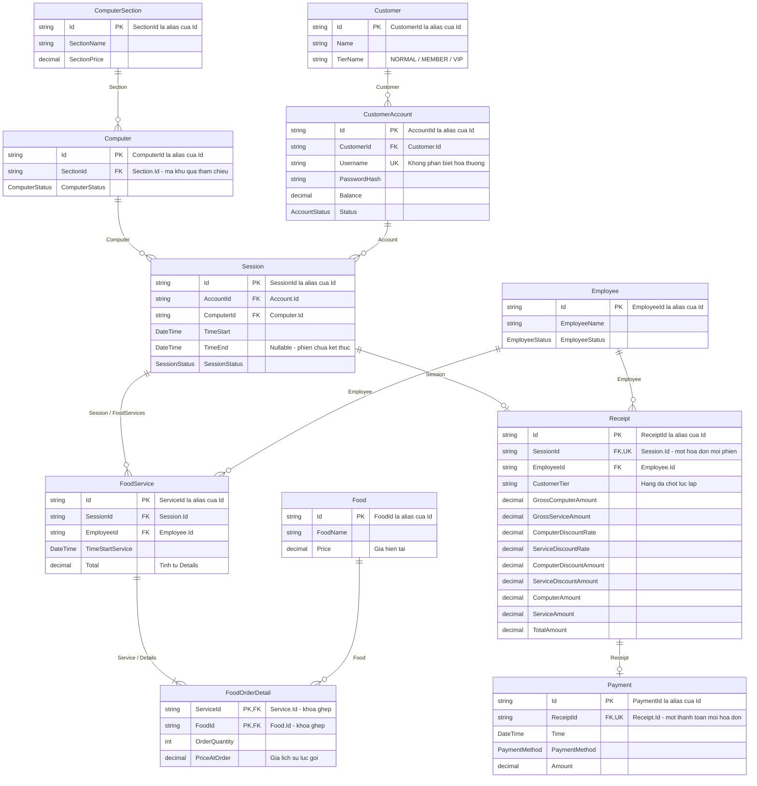

# Sơ đồ quan hệ và hướng dẫn LINQ cho NetCafeMIS C#

Sơ đồ dựa trên các lớp trong `NetCafeMis/Models/` và ràng buộc của các service trên nhánh `codex/csharp-version`.

Project dùng danh sách trong bộ nhớ và tham chiếu đối tượng. **PK/FK dưới đây là cách biểu diễn quan hệ để truy vấn hoặc thiết kế database; hiện chưa có database hay cấu hình Entity Framework.** Các trường FK trên sơ đồ là tên quy ước, kèm đường truy cập thật trong chú thích. Ví dụ `Computer` có thuộc tính `Section`; lấy mã khu bằng `computer.Section.Id`, không phải `computer.SectionId`.

## 1. Sơ đồ ERD tổng quát

`PK` = khóa chính; `FK` = khóa ngoại; `UK` = khóa duy nhất. `||` = đúng một, `o|` = không hoặc một, `o{` = không hoặc nhiều, `|{` = một hoặc nhiều.



Các quan hệ một hóa đơn/một phiên và một thanh toán/một hóa đơn được service bảo vệ. Một đơn món **đã ghi nhận** có ít nhất một dòng do `Seal()` kiểm tra; đơn đang tạo tạm có thể chưa có dòng. Một máy có nhiều phiên trong lịch sử, nhưng chỉ một phiên ACTIVE tại một thời điểm khi dùng service đúng luồng.

`NormalCustomer`, `MemberCustomer`, `VipCustomer` là các lớp con của `Customer`, cùng nằm trong `cafe.Customers`. Chúng cung cấp chính sách giảm giá; không phải ba bảng có khóa ngoại tới `Customer` trong model hiện tại.

## 2. Khóa chính và khóa ngoại thực tế khi viết LINQ

`Id` và tên chuyên biệt như `ComputerId` trả về cùng một giá trị, không phải hai khóa khác nhau. Mã duy nhất trong danh sách của từng loại đối tượng; không cần duy nhất chung giữa mọi loại.

| Lớp | PK / định danh | FK quy ước | Biểu thức C# thật |
|---|---|---|---|
| ComputerSection | `Id` = `SectionId` | — | `section.Id` |
| Computer | `Id` = `ComputerId` | SectionId | `computer.Section.Id` |
| Customer | `Id` = `CustomerId` | — | `customer.Id` |
| CustomerAccount | `Id` = `AccountId` | CustomerId | `account.Customer.Id` |
| Session | `Id` = `SessionId` | AccountId, ComputerId | `session.Account.Id`, `session.Computer.Id` |
| Employee | `Id` = `EmployeeId` | — | `employee.Id` |
| FoodService | `Id` = `ServiceId` | SessionId, EmployeeId | `service.Session.Id`, `service.Employee.Id` |
| Food | `Id` = `FoodId` | — | `food.Id` |
| FoodOrderDetail | Khóa ghép quy ước `(ServiceId, FoodId)` | ServiceId, FoodId | `detail.Service.Id`, `detail.Food.Id` |
| Receipt | `Id` = `ReceiptId` | SessionId, EmployeeId | `receipt.Session.Id`, `receipt.Employee.Id` |
| Payment | `Id` = `PaymentId` | ReceiptId | `payment.Receipt.Id` |

`FoodOrderDetail` không có thuộc tính `Id`, không triển khai `IIdentifiable`. Khóa ghép trên là cách biểu diễn hợp lý khi chuyển dữ liệu do service ghi nhận sang quan hệ: cùng món trong một đơn được gộp số lượng nếu cùng giá; khác giá bị từ chối.

## 3. Các nguồn dữ liệu LINQ

```csharp
NetCafe cafe = SampleData.Sample();
```

| Đối tượng cần truy vấn | Nguồn |
|---|---|
| Khu máy | `cafe.Sections` |
| Máy tính | `cafe.Computers` |
| Khách | `cafe.Customers` |
| Tài khoản | `cafe.Accounts` |
| Phiên chơi | `cafe.Sessions` |
| Nhân viên | `cafe.Employees` |
| Món | `cafe.Foods` |
| Lần gọi món | `cafe.Services` |
| Toàn bộ dòng món | `cafe.Services.SelectMany(s => s.Details)` |
| Hóa đơn | `cafe.Receipts` |
| Thanh toán | `cafe.Payments` |

Chưa có `cafe.FoodOrderDetails`; cần `SelectMany`. Danh sách chỉ đọc vẫn truy vấn LINQ bình thường. Nếu viết trong project khác, thêm `using System.Linq;`, `using NetCafeMis;`, `using NetCafeMis.Models;`, `using NetCafeMis.Services;`, `using NetCafeMis.Enums;`.

## 4. Các đường liên kết hay dùng

| Muốn lấy | Đường truy cập |
|---|---|
| Khu của máy | `computer.Section` |
| Khách của phiên | `session.Account.Customer` |
| Khu của phiên | `session.Computer.Section` |
| Đơn món của phiên | `session.FoodServices` |
| Dòng món của phiên | `session.FoodServices.SelectMany(s => s.Details)` |
| Khách của đơn món | `service.Session.Account.Customer` |
| Món của dòng đơn | `detail.Food` |
| Nhân viên xử lý dòng đơn | `detail.Service.Employee` |
| Khách của hóa đơn | `receipt.Session.Account.Customer` |
| Khu của hóa đơn | `receipt.Session.Computer.Section` |
| Khách của thanh toán | `payment.Receipt.Session.Account.Customer` |
| Khu của thanh toán | `payment.Receipt.Session.Computer.Section` |

Model không có mọi liên kết ngược. Không có `section.Computers`, `customer.Accounts`, `account.Sessions`, `session.Receipt`, `receipt.Payment` hoặc `employee.Receipts`. Tìm chúng bằng `Where`, `Any` hoặc join từ các danh sách trên `cafe`.

## 5. Ví dụ LINQ theo đúng model

Các ví dụ độc lập dưới đây dùng `cafe = SampleData.Sample()`, không đổi dữ liệu. Đây là ví dụ sử dụng sơ đồ; chưa phải bộ 30 truy vấn trong đặc tả.

Đã trích các đoạn code từ tài liệu, biên dịch bằng .NET 8 và kiểm tra kết quả của cả tám ví dụ trên dữ liệu mẫu.

### A. Máy đang trống và khu của máy — Where, Select

```csharp
var availableComputers = cafe.Computers
    .Where(c => c.ComputerStatus == ComputerStatus.AVAILABLE)
    .Select(c => new
    {
        ComputerId = c.Id,
        SectionId = c.Section.Id,
        c.Section.SectionName,
        c.Section.SectionPrice
    })
    .ToList();
```

Kết quả mẫu: PC01, PC03, PC04, PC06. PC02 đang dùng, PC05 bảo trì.

### B. Phiên, tài khoản, khách, máy và khu — tham chiếu đối tượng

```csharp
var sessionOverview = cafe.Sessions.Select(s => new
{
    SessionId = s.Id,
    AccountId = s.Account.Id,
    s.Account.Username,
    CustomerId = s.Account.Customer.Id,
    CustomerName = s.Account.Customer.Name,
    ComputerId = s.Computer.Id,
    SectionName = s.Computer.Section.SectionName,
    s.TimeStart,
    s.TimeEnd,
    s.SessionStatus
}).ToList();
```

Không cần join cho những đối tượng đã có tham chiếu sẵn. Mẫu có bốn phiên; S04 có `TimeEnd == null`.

### C. Ghép máy với khu bằng mã — Join

```csharp
var computerSections = (
    from computer in cafe.Computers
    join section in cafe.Sections
        on computer.Section.Id equals section.Id
    select new
    {
        ComputerId = computer.Id,
        SectionId = section.Id,
        section.SectionName
    }
).ToList();
```

`computer.Section.Id` đóng vai trò FK; `section.Id` đóng vai trò PK. Mẫu có sáu dòng kết quả.

### D. Món bán được bao nhiêu — SelectMany, GroupBy, Sum

```csharp
var foodSales = cafe.Services
    .SelectMany(service => service.Details)
    .GroupBy(detail => detail.Food.Id)
    .Select(group => new
    {
        FoodId = group.Key,
        FoodName = group.First().Food.FoodName,
        Quantity = group.Sum(detail => detail.OrderQuantity),
        GrossAmount = group.Sum(detail => detail.CalculateAmount())
    })
    .OrderBy(x => x.FoodId)
    .ToList();
```

Mẫu: F01 bán 3 phần, tiền gốc 45000; F02 bán 3 phần, tiền gốc 30000. Bao gồm đơn của phiên đang chơi. Đây là tiền món đã gọi theo giá lịch sử, chưa phải doanh thu đã thu hoặc tiền món sau giảm.

### E. Hóa đơn chưa thanh toán — Any

```csharp
var unpaidReceipts = cafe.Receipts
    .Where(receipt => !cafe.Payments.Any(payment => payment.Receipt.Id == receipt.Id))
    .Select(receipt => new
    {
        ReceiptId = receipt.Id,
        CustomerName = receipt.Session.Account.Customer.Name,
        receipt.TotalAmount
    })
    .ToList();
```

Mẫu chỉ có R02, tiền 60000. Receipt không có `Payment` hoặc cờ `IsPaid`; kiểm tra trong `cafe.Payments`.

### F. Phiên đã kết thúc nhưng chưa có hóa đơn — Where, Any

```csharp
var completedWithoutReceipt = cafe.Sessions
    .Where(session => session.SessionStatus == SessionStatus.COMPLETED
        && !cafe.Receipts.Any(receipt => receipt.Session.Id == session.Id))
    .Select(session => session.Id)
    .ToList();
```

Mẫu chỉ có S03. Không đưa S04 vào vì phiên này còn ACTIVE.

### G. Thực thu theo khu trong ngày — lọc Payment.Time, GroupBy

```csharp
DateTime day = new(2026, 10, 5);
DateTime nextDay = day.AddDays(1);

var dailyRevenue = cafe.Payments
    .Where(payment => payment.Time >= day && payment.Time < nextDay)
    .GroupBy(payment => payment.Receipt.Session.Computer.Section.Id)
    .Select(group => new
    {
        SectionId = group.Key,
        Collected = group.Sum(payment => payment.Amount)
    })
    .ToList();
```

Mẫu có CS01 = 49000; CS02 chưa có thanh toán nên không xuất hiện trong nhóm. Muốn hiện mọi khu kể cả doanh thu 0 thì dùng group join như ví dụ tiếp theo, ghép với Payment theo đường `Receipt.Session.Computer.Section.Id`.

### H. Đếm máy ở mọi khu, kể cả khu chưa có máy — GroupJoin

```csharp
var sectionCounts = (
    from section in cafe.Sections
    join computer in cafe.Computers
        on section.Id equals computer.Section.Id into computers
    select new
    {
        SectionId = section.Id,
        section.SectionName,
        ComputerCount = computers.Count()
    }
).ToList();
```

Mẫu: CS01 có 3 máy, CS02 có 3 máy. `into computers` giữ khu dù không có máy; `join` thông thường sẽ loại khu đó.

## 6. Các điểm cần nhớ khi viết 30 truy vấn

- Dùng `Id` hoặc alias chuyên biệt để ghép mã; không ghép bằng tên khách, tên món hoặc username.
- Customer và CustomerAccount là hai đối tượng khác nhau. Khách có thể có nhiều tài khoản; muốn thống kê theo khách thì nhóm theo `Account.Customer.Id`, theo tài khoản thì nhóm theo `Account.Id`.
- FoodService là **một lần gọi món**; FoodOrderDetail là **một dòng món**. Đếm đơn, đếm dòng và tổng số lượng là ba phép tính khác nhau.
- Không cộng `Food.Price` để tính lịch sử bán món; dùng `PriceAtOrder * OrderQuantity` hoặc `CalculateAmount()`.
- Tổng hóa đơn dùng `Receipt.TotalAmount`; tiền thực thu dùng `Payment.Amount`. Tổng hóa đơn mẫu 109000, thực thu 49000.
- Muốn phân tích hóa đơn theo hạng/giảm giá tại lúc lập thì dùng `Receipt.CustomerTier` và các khoản đã chốt trên Receipt.
- Receipt không có ngày lập riêng. Dùng `Session.TimeEnd` nếu thống kê theo ngày kết thúc phiên; dùng `Payment.Time` nếu thống kê ngày thu tiền. Ghi rõ ý nghĩa ngày trong mỗi truy vấn.
- `TimeEnd` có thể null. Muốn tính thời lượng đã chơi trọn phiên, lọc `TimeEnd.HasValue` trước. `Session.CalculateAmount()` ném lỗi khi phiên chưa kết thúc; tạm tính dùng `AmountAt(at)`.
- Dùng khoảng ngày `[day, day.AddDays(1))`. LINQ đang chạy trên đối tượng trong bộ nhớ, không tự phát sinh SQL.
- Enum trạng thái và ba lớp con khách không phải các bảng danh mục cần join trong project hiện tại.
