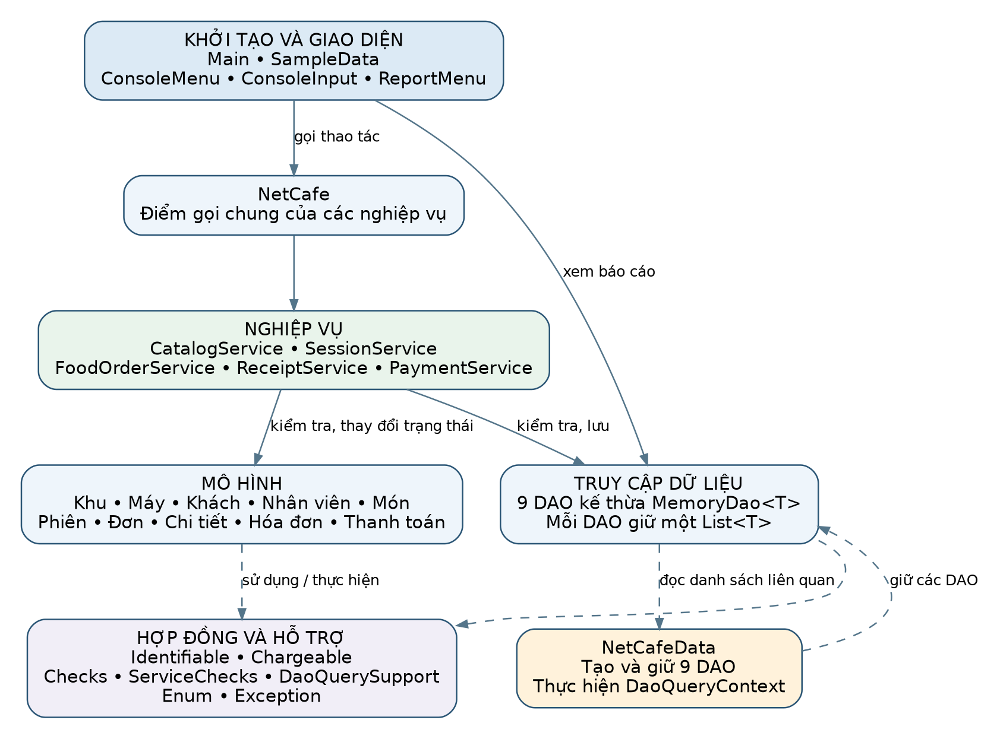
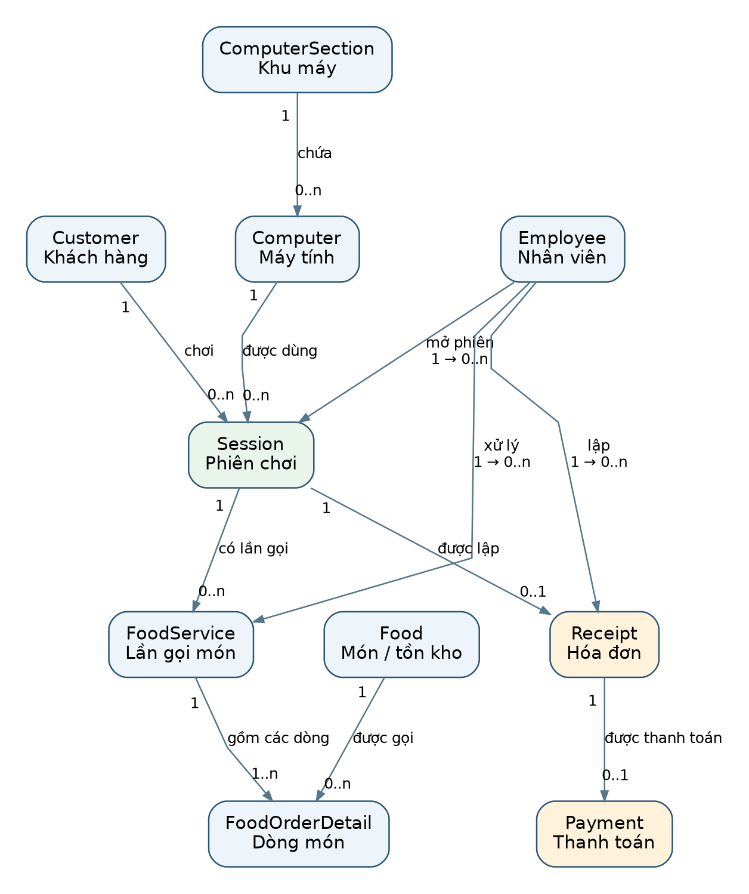

# 1. Tổng quan dự án

## 1.1. Mục đích

NetCafeMIS là ứng dụng quản lý hoạt động của một quán net nhỏ, từ chuẩn bị danh mục máy và khách hàng đến mở phiên chơi, phục vụ món, tính tiền và xem báo cáo. Dự án thể hiện cách xây dựng mô hình hướng đối tượng, tổ chức trách nhiệm giữa các lớp và truy vấn dữ liệu bằng Java Stream/Lambda.

Tài liệu này đặc tả phiên bản Java trong file `java.zip` gần nhất do người dùng cung cấp, đối chiếu với hai hình sơ đồ lớp và sơ đồ quan hệ nghiệp vụ. Bộ dữ liệu quán nhỏ bổ sung được dùng để minh họa và kiểm thử, không thay thế dữ liệu mặc định trong `SampleData`.

## 1.2. Phạm vi chức năng

Hệ thống hỗ trợ quản lý khu máy, máy tính, khách hàng, nhân viên và danh mục món; nhập thêm tồn kho; mở và kết thúc phiên; ghi nhận gọi món; lập hóa đơn; ghi nhận thanh toán; tra cứu và thực hiện 30 truy vấn báo cáo.

Ứng dụng chạy trên console. Dữ liệu được tạo bằng code và lưu trong các danh sách `List` ở bộ nhớ. DAO cung cấp thao tác lưu và truy vấn trên các danh sách này. Khi thoát chương trình, các thay đổi trong lần chạy kết thúc cùng tiến trình.

## 1.3. Phạm vi triển khai hiện tại

| Nội dung | Đặc điểm của phiên bản được đặc tả |
|---|---|
| Ngôn ngữ | Java; gói dự án đã chuẩn hóa để biên dịch với JDK 21 trở lên |
| Giao diện | Menu console, đầu vào và đầu ra UTF-8 |
| Lưu trữ | Danh sách trong bộ nhớ, dùng chung trong một đối tượng `NetCafe` |
| Truy cập dữ liệu | Các DAO kế thừa `MemoryDao<T>`; truy vấn bằng Stream/Lambda |
| Tiền | `BigDecimal`; ví dụ nghiệp vụ dùng đồng Việt Nam |
| Số lượng và tồn kho | `int`, phục vụ dữ liệu quy mô quán nhỏ |
| Thời gian | `LocalDate`, `LocalDateTime`, `Duration`; nhân viên nhập thời gian để mô phỏng |
| Phương thức thanh toán | Tiền mặt, chuyển khoản, thẻ; ghi nhận phương thức trong dữ liệu |
| Vận hành | Một tiến trình console, xử lý thao tác lần lượt |

Phiên bản này không kết nối SQL/JDBC, không có màn hình đăng nhập hoặc phân quyền tài khoản, không có số dư ví khách hàng và không áp dụng hạng khách/giảm giá. Chuyển khoản và thẻ được ghi nhận trong hệ thống, chưa tích hợp xác nhận với ngân hàng hay cổng thanh toán. Các thao tác CRUD đã triển khai chủ yếu là thêm và đọc; tài liệu không đặt tên chức năng sửa/xóa khi code chưa có.

# 2. Người sử dụng và thuật ngữ

## 2.1. Người sử dụng

| Đối tượng | Vai trò trong quy trình |
|---|---|
| Nhân viên quán | Nhập danh mục, chọn khách và máy, mở/kết thúc phiên, nhận đơn món, lập hóa đơn và ghi nhận thanh toán |
| Người quản lý | Xem tình trạng máy, tồn kho, hóa đơn, doanh thu và báo cáo tổng hợp thông qua cùng giao diện console |
| Khách hàng | Người sử dụng máy và gọi món; được biểu diễn bằng `Customer`, nhân viên thao tác thay trên chương trình |

Nhân viên và người quản lý là vai trò nghiệp vụ để diễn giải chức năng. Chương trình hiện chưa xác thực người đang ngồi trước console hoặc cấp quyền chức năng theo tài khoản. Thuộc tính nhân viên trong phiên, đơn và hóa đơn dùng để ghi nhận người phụ trách từng nghiệp vụ.

## 2.2. Thuật ngữ

| Thuật ngữ | Ý nghĩa |
|---|---|
| Khu máy | Nhóm máy dùng chung đơn giá chơi theo giờ, ví dụ khu thường và khu VIP |
| Phiên chơi | Một lần sử dụng một máy của một khách, có người mở, giờ bắt đầu, trạng thái và giờ kết thúc thực tế |
| Lần gọi món | Một đơn phục vụ trong phiên, gồm một hoặc nhiều dòng món; lớp mô hình là `FoodService` |
| Chi tiết gọi món | Một món và tổng số lượng của món đó trong một lần gọi; lớp `FoodOrderDetail` |
| Tồn kho | Số phần còn có thể bán của một món |
| Hóa đơn | Bản chốt tiền máy và tiền món của một phiên đã kết thúc; lớp `Receipt` |
| Thanh toán | Giao dịch trả đủ tổng tiền của một hóa đơn; lớp `Payment` |
| Thực thu | Tổng tiền các giao dịch thanh toán đã được ghi nhận |
| Còn thu | Giá trị hóa đơn đã lập nhưng chưa có giao dịch thanh toán |
| DAO | Thành phần giữ và truy vấn dữ liệu trong danh sách |

`FoodService` là đối tượng đơn món; `FoodOrderService` là lớp xử lý nghiệp vụ tạo đơn, kiểm tra điều kiện và trừ kho. `Receipt` và `Payment` là hai đối tượng riêng: có hóa đơn chưa đồng nghĩa đã thu tiền.

# 3. Kiến trúc và tổ chức chương trình

## 3.1. Phân chia trách nhiệm



| Nhóm | Các lớp chính | Trách nhiệm |
|---|---|---|
| Khởi tạo và giao diện | `Main`, `SampleData`, `ConsoleMenu`, `ConsoleInput`, `ReportMenu` | Nạp dữ liệu, nhận lựa chọn, kiểm tra định dạng và trình bày kết quả |
| Điểm gọi nghiệp vụ | `NetCafe` | Giữ một bộ dữ liệu và các Service; cung cấp phương thức thuận tiện cho giao diện |
| Xử lý nghiệp vụ | `CatalogService`, `SessionService`, `FoodOrderService`, `ReceiptService`, `PaymentService` | Kiểm tra điều kiện và phối hợp việc ghi dữ liệu |
| Mô hình | Các lớp khách, máy, phiên, món, đơn, hóa đơn, thanh toán | Giữ thuộc tính và thực hiện hành vi thuộc đối tượng |
| Truy cập dữ liệu | 9 DAO, `MemoryDao<T>`, `DaoQueryContext`, `DaoQuerySupport` | Lưu danh sách, tìm đối tượng, tổng hợp và định dạng kết quả truy vấn |
| Dữ liệu dùng chung | `NetCafeData` | Tạo và giữ 9 DAO; cung cấp danh sách qua `DaoQueryContext` |
| Kiểm tra và lỗi | `Checks`, `ServiceChecks`, enum và exception | Kiểm tra giá trị, tham chiếu, trạng thái và báo lỗi nghiệp vụ |

Đường đi của thao tác ghi: `ConsoleMenu → NetCafe/Service → Model và DAO`. Đường đi của báo cáo: `ReportMenu → DAO → các danh sách trong cùng NetCafeData → kết quả hiển thị`. `NetCafe` đóng vai trò đầu mối sử dụng các Service; quy tắc nghiệp vụ cụ thể nằm ở Service và Model.

## 3.2. Dữ liệu dùng chung và quyền ghi

Mỗi `MemoryDao<T>` giữ một `ArrayList<T>` riêng. `NetCafeData` tập hợp các DAO, không duy trì thêm một bản sao độc lập của toàn bộ danh sách. Vì Service và DAO báo cáo cùng dùng các đối tượng này, dữ liệu vừa thêm được truy vấn thấy ngay trong cùng lần chạy.

`findAll()` trả danh sách chỉ đọc về mặt cấu trúc: bên gọi không thể dùng danh sách đó để thêm/xóa phần tử. Đây không phải bản sao bất biến toàn bộ đồ thị đối tượng. Trạng thái phiên, máy và tồn món vẫn thay đổi bằng các hành vi nghiệp vụ được cho phép.

`MemoryDao.save(value, caller)` kiểm tra `caller` phải đúng đối tượng quản lý dữ liệu đã gắn với DAO, kiểm tra giá trị và mã trùng rồi mới thêm. Các Service truyền `NetCafeData` phù hợp. Cơ chế này phục vụ kiểm soát thao tác nội bộ, không thay thế đăng nhập/phân quyền người dùng.

## 3.3. Interface và cơ chế hướng đối tượng

| Thành phần | Lớp thực hiện hoặc sử dụng | Ý nghĩa |
|---|---|---|
| `Identifiable.getId()` | Khu, máy, khách, nhân viên, món, phiên, đơn món, hóa đơn, thanh toán | Thống nhất cách lấy mã cho DAO dùng kiểu tổng quát |
| `Chargeable.calculateAmount()` | `Session`, `FoodService`, `FoodOrderDetail`, `Receipt` | Thống nhất hành vi tính thành tiền; mỗi lớp có công thức phù hợp |
| `MemoryDao<T extends Identifiable>` | 9 DAO chuyên biệt | Tái sử dụng lưu trữ, kiểm tra mã, tìm kiếm và duyệt dữ liệu |
| `DaoQueryContext` | `NetCafeData` thực hiện; DAO sử dụng | Cung cấp danh sách liên quan để truy vấn giữa các loại đối tượng |
| Đóng gói | Các thuộc tính được giữ kín; nhiều thuộc tính là `final` | Duy trì trạng thái thông qua constructor và phương thức nghiệp vụ |
| Kết hợp đối tượng | Phiên tham chiếu khách/máy/nhân viên; đơn chứa chi tiết | Mô hình hóa mối liên hệ thực tế và phối hợp tính tiền |

`FoodOrderDetail` không thực hiện `Identifiable` và không có DAO riêng trong phiên bản này. `Payment` có mã định danh nhưng không thực hiện `Chargeable`: số tiền thanh toán được ghi nhận và kiểm tra so với hóa đơn.

# 4. Mô hình dữ liệu nghiệp vụ

Các bảng dưới đây ghi tên thuộc tính chính theo code Java. Mã là định danh trong từng loại đối tượng. Các tham chiếu như `customer`, `computer`, `session` là tham chiếu đối tượng, không phải cột khóa ngoại SQL đang tồn tại.

## 4.1. ComputerSection — khu máy

| Thuộc tính | Kiểu | Ý nghĩa và ràng buộc |
|---|---|---|
| `sectionId` | `String` | Mã khu, không trống, duy nhất trong DAO khu |
| `sectionName` | `String` | Tên khu |
| `sectionPrice` | `BigDecimal` | Giá chơi mỗi giờ, không âm |

Khu được thêm trước khi thêm máy thuộc khu. Một khu dùng chung đơn giá cho các máy tham chiếu tới nó. Giá và tên được xác định khi tạo đối tượng; menu hiện không có chức năng cập nhật giá khu.

## 4.2. Computer — máy tính

| Thuộc tính | Kiểu | Ý nghĩa và ràng buộc |
|---|---|---|
| `computerId` | `String` | Mã máy duy nhất trong DAO máy |
| `section` | `ComputerSection` | Khu máy đã đăng ký trong quán |
| `computerStatus` | `ComputerStatus` | Sẵn sàng, đang dùng hoặc bảo trì |

Máy mới chỉ được đăng ký với trạng thái `AVAILABLE` hoặc `MAINTENANCE`; Service không nhận máy mới ở `IN_USE` khi chưa có phiên. Trạng thái được điều chỉnh khi mở/kết thúc phiên. Trường kỹ thuật `owner` và các phương thức `attach`, `setComputerStatus` kiểm soát việc thay đổi bằng ngữ cảnh dữ liệu phù hợp.

## 4.3. Customer — khách hàng

| Thuộc tính | Kiểu | Ý nghĩa và ràng buộc |
|---|---|---|
| `id` | `String` | Mã khách duy nhất trong DAO khách; cũng được trả bởi `getCustomerId()` |
| `name` | `String` | Tên khách |

Hai khách có thể trùng tên khi khác mã. Các nghiệp vụ chọn khách bằng mã và đối tượng đã đăng ký, không dùng tên làm định danh duy nhất. Khách có thể có nhiều phiên theo lịch sử nhưng tối đa một phiên đang hoạt động tại một thời điểm trong luồng xử lý tuần tự.

## 4.4. Employee — nhân viên

| Thuộc tính | Kiểu | Ý nghĩa và ràng buộc |
|---|---|---|
| `employeeId` | `String` | Mã nhân viên duy nhất |
| `employeeName` | `String` | Tên nhân viên |
| `employeeStatus` | `EmployeeStatus` | `ACTIVE` hoặc `INACTIVE` |

Nhân viên hoạt động được chọn để mở phiên, xử lý gọi món và lập hóa đơn. Người mở phiên, người xử lý đơn và người lập hóa đơn có thể khác nhau. `Payment` hiện không có thuộc tính nhân viên thu tiền; báo cáo giá trị hóa đơn theo nhân viên gắn với người lập hóa đơn.

## 4.5. Food — món và tồn kho

| Thuộc tính | Kiểu | Ý nghĩa và ràng buộc |
|---|---|---|
| `foodId` | `String` | Mã món duy nhất |
| `foodName` | `String` | Tên món ăn hoặc đồ uống |
| `price` | `BigDecimal` | Đơn giá không âm, cố định trên đối tượng |
| `stockQuantity` | `int` | Tồn kho không âm; tăng khi nhập và giảm khi gọi món thành công |

Nhập thêm dùng số lượng dương và không làm vượt miền `int`. `Food` gắn với ngữ cảnh sở hữu khi được thêm vào quán; thay đổi tồn kho đi qua Service của ngữ cảnh đó. Phiên bản hiện tại quản lý tồn tổng, chưa có đối tượng phiếu nhập, nhà cung cấp hoặc giá vốn.

## 4.6. Session — phiên chơi

| Thuộc tính | Kiểu | Ý nghĩa và ràng buộc |
|---|---|---|
| `sessionId` | `String` | Mã phiên duy nhất |
| `customer` | `Customer` | Khách sử dụng máy |
| `computer` | `Computer` | Máy được sử dụng |
| `openedBy` | `Employee` | Nhân viên mở phiên |
| `timeStart` | `LocalDateTime` | Giờ bắt đầu, xác định khi mở |
| `timeEnd` | `LocalDateTime` | Giờ kết thúc thực tế; `null` khi đang chơi |
| `sessionStatus` | `SessionStatus` | `ACTIVE` hoặc `COMPLETED` |
| `foodServices` | `List<FoodService>` | Các lần gọi món đã liên kết vào phiên |

`Session` giữ thêm `owner` để kiểm tra thao tác nội bộ. `recordFoodService()` kiểm tra đơn thuộc đúng phiên và đã được ghi nhận trong ngữ cảnh dữ liệu. `endSession()` kiểm tra trạng thái, thời gian và các lần gọi món, sau đó cập nhật phiên và trả máy về sẵn sàng. `amountAt()` tính tiền máy tại thời điểm truyền vào; `calculateAmount()` chốt theo giờ kết thúc thực tế.

## 4.7. FoodService — một lần gọi món

| Thuộc tính | Kiểu | Ý nghĩa và ràng buộc |
|---|---|---|
| `serviceId` | `String` | Mã đơn món duy nhất |
| `session` | `Session` | Phiên được phục vụ |
| `employee` | `Employee` | Nhân viên nhận/xử lý đơn |
| `timeStartService` | `LocalDateTime` | Thời gian gọi món, không trước giờ mở phiên |
| `details` | `List<FoodOrderDetail>` | Ít nhất một dòng món, được tạo đầy đủ trong constructor |

Chi tiết đơn trả ra dưới dạng danh sách chỉ đọc. Mỗi món trùng trong mảng đầu vào được gộp trước khi tạo chi tiết. Tổng tiền đơn bằng tổng thành tiền các dòng.

## 4.8. FoodOrderDetail — chi tiết gọi món

| Thuộc tính | Kiểu | Ý nghĩa và ràng buộc |
|---|---|---|
| `service` | `FoodService` | Lần gọi món chứa dòng này |
| `food` | `Food` | Món được gọi |
| `orderQuantity` | `int` | Số phần, bắt buộc lớn hơn 0 |

Một dòng thuộc một đơn và tham chiếu một món. Chi tiết không có mã độc lập trong code hiện tại. Thành tiền lấy đơn giá cố định của món nhân số lượng. Hệ thống chưa có chỉnh sửa, hủy đơn hoặc hoàn kho sau khi đơn được ghi nhận.

## 4.9. Receipt — hóa đơn

| Thuộc tính | Kiểu | Ý nghĩa và ràng buộc |
|---|---|---|
| `id` | `String` | Mã hóa đơn duy nhất; cũng được trả bởi `getReceiptId()` |
| `session` | `Session` | Phiên đã hoàn tất |
| `employee` | `Employee` | Người lập hóa đơn |
| `serviceAmount` | `BigDecimal` | Tổng tiền các đơn món của phiên |
| `computerAmount` | `BigDecimal` | Tiền máy chốt theo thời gian chơi |

Hai khoản tiền được Service tính khi lập hóa đơn và giữ cố định trong đối tượng. `getTotalAmount()`/`calculateAmount()` trả tổng hai khoản. Mỗi phiên có tối đa một hóa đơn qua `ReceiptService`.

## 4.10. Payment — giao dịch thanh toán

| Thuộc tính | Kiểu | Ý nghĩa và ràng buộc |
|---|---|---|
| `paymentId` | `String` | Mã thanh toán duy nhất |
| `receipt` | `Receipt` | Hóa đơn đã đăng ký trong quán |
| `time` | `LocalDateTime` | Không trước giờ kết thúc phiên |
| `paymentMethod` | `PaymentMethod` | Tiền mặt, chuyển khoản hoặc thẻ |
| `amount` | `BigDecimal` | Bằng đúng tổng hóa đơn |

Mỗi hóa đơn có tối đa một giao dịch qua `PaymentService`. Code yêu cầu trả đủ một lần; chưa có trả góp, trả một phần, hoàn tiền hoặc tính tiền thừa. Hóa đơn không có thuộc tính thời gian phát hành nên điều kiện thời gian thanh toán hiện đối chiếu với giờ kết thúc phiên.

# 5. Quan hệ giữa các đối tượng



Trong bảng sau, mỗi dòng thể hiện số đối tượng B có thể liên quan tới một đối tượng A. Mỗi đối tượng B ở các quan hệ này tham chiếu đúng một A tương ứng.

| A | B | Số lượng B trên một A | Ý nghĩa |
|---|---|---|---|
| `ComputerSection` | `Computer` | 0..n | Khu có thể chưa có máy hoặc chứa nhiều máy |
| `Computer` | `Session` | 0..n | Máy có nhiều phiên lịch sử; tối đa một phiên active |
| `Customer` | `Session` | 0..n | Khách có thể chưa chơi hoặc chơi nhiều lần; tối đa một phiên active |
| `Employee` | `Session` | 0..n | Nhân viên mở nhiều phiên |
| `Session` | `FoodService` | 0..n | Phiên có thể không gọi món hoặc gọi nhiều lần |
| `Employee` | `FoodService` | 0..n | Nhân viên xử lý nhiều đơn |
| `FoodService` | `FoodOrderDetail` | 1..n | Mỗi đơn có ít nhất một dòng chi tiết |
| `Food` | `FoodOrderDetail` | 0..n | Một món có thể được dùng trong nhiều dòng ở nhiều đơn |
| `Session` | `Receipt` | 0..1 | Phiên chưa có hóa đơn hoặc đã lập một hóa đơn |
| `Employee` | `Receipt` | 0..n | Nhân viên lập nhiều hóa đơn |
| `Receipt` | `Payment` | 0..1 | Hóa đơn chưa thanh toán hoặc có một thanh toán |

Quan hệ `Session–Receipt` và `Receipt–Payment` được giới hạn bởi Service, không phải bởi một trường danh sách trong Model. Các danh sách DAO vẫn là nơi tra cứu hóa đơn/thanh toán liên quan. Tương tự, khu không cần giữ trực tiếp danh sách máy vì truy vấn có thể lọc `Computer.section`.

# 6. Trạng thái và quy tắc nghiệp vụ

## 6.1. Các tập trạng thái

| Enum | Giá trị | Ý nghĩa |
|---|---|---|
| `ComputerStatus` | `AVAILABLE`, `IN_USE`, `MAINTENANCE` | Máy sẵn sàng, đang sử dụng, bảo trì |
| `SessionStatus` | `ACTIVE`, `COMPLETED` | Phiên đang hoạt động, đã kết thúc |
| `EmployeeStatus` | `ACTIVE`, `INACTIVE` | Nhân viên được phép thực hiện nghiệp vụ hoặc đang ngừng hoạt động |
| `PaymentMethod` | `CASH`, `BANK_TRANSFER`, `CARD` | Phương thức thanh toán được ghi nhận |

Mở phiên hợp lệ chuyển máy `AVAILABLE → IN_USE` và tạo phiên `ACTIVE`. Kết thúc hợp lệ chuyển phiên `ACTIVE → COMPLETED`, đồng thời chuyển máy `IN_USE → AVAILABLE`. `MAINTENANCE` loại máy khỏi việc mở phiên; menu hiện không có một chức năng bảo trì riêng để thực hiện chuyển trạng thái sau khi thêm máy.

## 6.2. Quy tắc định danh và tham chiếu

- **BR01:** Mã đối tượng bắt buộc có nội dung và duy nhất trong DAO của loại đối tượng đó. Mã được constructor xử lý bỏ khoảng trắng thông thường ở hai đầu. Tên không được là null hoặc chuỗi trống theo phép `trim()` hiện có.
- **BR02:** Khách, máy, nhân viên, món và các đối tượng liên quan phải đã đăng ký trong cùng bộ dữ liệu trước khi thực hiện nghiệp vụ. Code dùng đối tượng đã lưu, không coi một đối tượng vừa tạo có cùng mã là tự động thuộc quán.
- **BR03:** Tên khách không phải mã duy nhất. Khách trùng tên được phân biệt bằng mã.
- **BR04:** Giá khu, giá món và các khoản tiền không âm. Miền giá trị hiện cho phép số 0.

## 6.3. Quy tắc phiên và thời gian

- **BR05:** Chỉ mở phiên trên máy `AVAILABLE`, với nhân viên `ACTIVE` và thời gian bắt đầu có giá trị.
- **BR06:** Khách không có một phiên `ACTIVE` khác; máy không được phục vụ hai phiên active trong luồng thao tác tuần tự.
- **BR07:** Phiên mới của cùng khách hoặc máy phải bắt đầu từ lúc các phiên cũ đã kết thúc trở đi. Bắt đầu đúng thời điểm phiên cũ kết thúc được chấp nhận. Cách kiểm tra hiện tại phù hợp bổ sung lịch sử theo thứ tự thời gian của từng khách/máy.
- **BR08:** Kết thúc phiên yêu cầu phiên còn `ACTIVE` và `timeEnd > timeStart`. Không kết thúc lại phiên đã hoàn tất.
- **BR09:** Giờ kết thúc không được trước bất kỳ lần gọi món nào đã ghi nhận. Có thể bằng giờ gọi món cuối.
- **BR10:** Khách có thể kết thúc sớm bằng cách nhân viên gọi `cafe.endSession(session, end)`. Giờ dùng để tính tiền là giờ kết thúc thực tế; mô hình hiện không có `plannedEndTime`.
- **BR11:** Thời gian do người dùng nhập để mô phỏng; chương trình không tự ép mọi giá trị phải bằng thời gian hiện tại trên máy tính. Menu nhận ngày `yyyy-MM-dd` và ngày giờ `yyyy-MM-dd HH:mm`, kiểm tra ngày có tồn tại.

## 6.4. Quy tắc gọi món và tồn kho

- **BR12:** Chỉ gọi món cho phiên active, do nhân viên active xử lý; thời gian đơn không trước giờ mở phiên.
- **BR13:** Đơn có ít nhất một món; mảng món và mảng số lượng phải cùng độ dài. Mỗi số lượng là số nguyên dương.
- **BR14:** Món lặp được gộp theo cùng đối tượng món trước khi kiểm tra kho. Tổng gộp một món trong một đơn không vượt miền `int`.
- **BR15:** Toàn bộ đơn phải đủ hàng. Trong luồng xử lý tuần tự, nếu một dòng không hợp lệ hoặc thiếu hàng thì đơn bị từ chối trước khi lưu và trừ kho.
- **BR16:** Đơn hợp lệ được lưu vào DAO, liên kết với phiên và giảm tồn từng món đúng số phần đã bán. Chi tiết đơn đã tạo không cho sửa qua danh sách trả về.
- **BR17:** Nhập hàng yêu cầu món đã đăng ký và lượng nhập dương; tồn sau nhập không vượt miền số nguyên đang dùng.

## 6.5. Quy tắc hóa đơn và thanh toán

- **BR18:** Chỉ lập hóa đơn cho phiên `COMPLETED`; mỗi phiên lập tối đa một lần; người lập phải là nhân viên active.
- **BR19:** Hóa đơn chốt tiền máy cộng tiền toàn bộ lần gọi món trong phiên. Các đơn có tổng tiền 0 vẫn là các lần gọi món đã tồn tại.
- **BR20:** Thanh toán yêu cầu hóa đơn đã đăng ký, chưa có giao dịch trước đó, số tiền bằng đúng tổng hóa đơn và thời gian không trước lúc kết thúc phiên.
- **BR21:** Một hóa đơn có thể chưa thanh toán; thực thu chỉ cộng các `Payment`. Hóa đơn chưa trả tạo số còn thu; phiên chưa có hóa đơn được thống kê riêng.

## 6.6. Phạm vi bảo đảm của quy trình

Các điều kiện trên mô tả nghiệp vụ đi qua Service trong ứng dụng console xử lý lần lượt. Trong bản hiện tại, gọi món và nhập kho có khóa trên ngữ cảnh dữ liệu; các nghiệp vụ còn lại chưa tạo thành cơ chế giao dịch đồng bộ cho toàn hệ thống. Triển khai phục vụ nhiều yêu cầu đồng thời cần bổ sung thiết kế đồng bộ/giao dịch trước khi dùng các quy tắc như một bảo đảm đa người dùng.

# 7. Đặc tả các chức năng

## 7.1. UC01 — Chuẩn bị dữ liệu danh mục

- **Người thực hiện:** nhân viên/người quản lý.
- **Đầu vào:** mã, tên và giá khu; mã máy, khu và trạng thái; mã/tên khách; mã/tên/trạng thái nhân viên; mã/tên/giá/tồn ban đầu của món.
- **Điều kiện trước:** khu đã tồn tại khi thêm máy. Các đối tượng mới chưa trùng mã trong cùng loại.
- **Luồng chính:** chọn chức năng thêm → nhập thông tin → `ConsoleInput` kiểm tra định dạng → tạo Model → gọi `NetCafe`/`CatalogService` → Service kiểm tra quan hệ → DAO lưu.
- **Kết quả:** thêm đúng một đối tượng vào danh sách, các truy vấn sau nhìn thấy đối tượng đó ngay.
- **Ngoại lệ:** mã/tên trống, tiền âm, tồn âm, mã trùng, khu chưa đăng ký hoặc thêm máy ở trạng thái đang dùng. Chương trình hiển thị lỗi và quay về menu.

Các mục menu tương ứng là 3–7. Một món mới có thể có tồn 0; máy mới có thể đang bảo trì. Thêm khách không yêu cầu đã có phiên.

## 7.2. UC02 — Xem và tra cứu dữ liệu

- **Đầu vào:** xem toàn bộ danh mục hoặc chọn loại đối tượng và nhập mã.
- **Luồng chính:** mục 1 trình bày các danh sách; mục 2 tìm trong một trong 9 loại dữ liệu. Mã tra cứu tại menu được xử lý bỏ khoảng trắng đầu/cuối trước khi đối chiếu.
- **Kết quả:** thông tin đối tượng hoặc thông báo không tìm thấy; không thay đổi dữ liệu.
- **Lưu ý triển khai:** tra cứu theo mã tại menu dùng hàm hỗ trợ của menu trên danh sách. DAO cũng có `findById()`, nhưng hàm nền này hiện so sánh chuỗi trực tiếp; không đồng nhất mọi quy tắc chuẩn hóa với menu.

## 7.3. UC03 — Nhập thêm hàng

- **Đầu vào:** mã món, lượng nhập.
- **Điều kiện trước:** món đã đăng ký, lượng nhập dương và kết quả cộng không vượt `int`.
- **Luồng chính:** chọn mục 17 → tìm món → nhập số lượng → `CatalogService.restockFood()` kiểm tra và gọi `Food.restock()`.
- **Kết quả:** tồn mới = tồn cũ + lượng nhập; báo cáo tồn thấp được cập nhật theo tồn mới.
- **Ngoại lệ:** món không tồn tại, số lượng không hợp lệ hoặc vượt giới hạn cộng; tồn giữ nguyên.

Menu giới hạn lượng nhập mỗi lần từ 1 đến 1.000.000; giới hạn kiểm tra trong Model áp dụng theo miền `int`. Nhập hàng không tạo doanh thu hoặc một chứng từ tài chính riêng.

## 7.4. UC04 — Mở phiên chơi

- **Đầu vào:** mã phiên, mã khách, mã máy, mã nhân viên mở và thời gian bắt đầu.
- **Điều kiện trước:** các đối tượng đã đăng ký; nhân viên active; máy sẵn sàng; khách không có phiên active; thời gian không chồng lịch sử liên quan.
- **Luồng chính:** chọn mục 8 → menu lấy đối tượng đã lưu theo mã → gọi `NetCafe.openSession()` → `SessionService` kiểm tra → tạo `Session` → lưu vào `SessionDao` → đổi máy sang `IN_USE`.
- **Kết quả:** phiên mới ở `ACTIVE`, `timeEnd = null`, máy đang dùng.
- **Ngoại lệ:** mã phiên trùng, máy bận/bảo trì, khách đang chơi, đối tượng không thuộc quán, nhân viên inactive, thời gian thiếu hoặc chồng lịch sử. Yêu cầu mở bị từ chối.

## 7.5. UC05 — Gọi món trong phiên

- **Đầu vào:** mã đơn, mã phiên, mã nhân viên xử lý, thời gian gọi và danh sách món/số lượng.
- **Điều kiện trước:** phiên active; nhân viên active; món đã đăng ký; thời gian không trước giờ mở; toàn bộ đơn đủ hàng.
- **Luồng chính:** chọn mục 10 → nhập các dòng món → `FoodOrderService.order()` kiểm tra đơn → gộp món lặp → kiểm tra đủ kho cho mọi món → tạo `FoodService` và các `FoodOrderDetail` → lưu đơn → liên kết phiên → trừ tồn.
- **Kết quả:** một đơn mới được nhận, tổng tiền tính theo các dòng, tồn giảm đúng số phần.
- **Ngoại lệ:** dữ liệu thiếu, hai mảng lệch độ dài, số lượng không dương, tổng gộp quá miền số nguyên, món chưa có, thiếu hàng, phiên đã kết thúc hoặc mã đơn trùng.

Menu hỗ trợ 1–20 dòng mỗi lần gọi, mỗi dòng có lượng 1–1.000.000. Bộ dữ liệu thực tế dùng chủ yếu 1–3 phần một đơn. Gọi lại món ở một đơn khác tạo một lần gọi mới; chương trình không tự hợp nhất hai đơn khác mã.

## 7.6. UC06 — Kết thúc phiên

- **Đầu vào:** mã phiên và thời gian kết thúc thực tế.
- **Điều kiện trước:** phiên thuộc quán và còn active; giờ kết thúc sau giờ mở, không trước lần gọi món cuối.
- **Luồng chính:** chọn mục 9 → `SessionService` kiểm tra phiên đã đăng ký → gọi `Session.endSession(end, data)` → Model kiểm tra → cập nhật giờ kết thúc, trạng thái phiên và trạng thái máy.
- **Kết quả:** phiên `COMPLETED`, máy `AVAILABLE`; có thể lập hóa đơn. Kết thúc phiên chưa tự lập hóa đơn hoặc tự ghi thanh toán.
- **Ngoại lệ:** thời gian sai, đã kết thúc trước đó hoặc có đơn món sau giờ kết thúc nhập vào. Trong luồng tuần tự, lỗi được phát hiện trước khi các trường kết thúc và trạng thái được cập nhật.

Ví dụ mở 15:00 và khách nghỉ 16:30: nhân viên nhập 16:30 để kết thúc. Không cần đợi đến một mốc 17:00 vì phiên hiện không lưu lịch đặt trước. Nếu đã ghi món lúc 16:40 thì nhập kết thúc 16:30 bị từ chối để bảo vệ tính nhất quán thời gian.

## 7.7. UC07 — Lập hóa đơn

- **Đầu vào:** mã hóa đơn, mã phiên và mã người lập.
- **Điều kiện trước:** phiên completed, chưa có hóa đơn, người lập active.
- **Luồng chính:** chọn mục 11 → `ReceiptService` kiểm tra → lấy tiền máy từ `session.calculateAmount()` → cộng tiền các đơn của phiên → tạo và lưu `Receipt`.
- **Kết quả:** hóa đơn chốt hai khoản tiền và tổng tiền; trạng thái máy không thay đổi do đã được giải phóng khi kết thúc phiên.
- **Ngoại lệ:** phiên còn chơi, hóa đơn/phiên không hợp lệ, nhân viên inactive, mã hóa đơn trùng hoặc phiên đã có hóa đơn.

## 7.8. UC08 — Thanh toán hóa đơn

- **Đầu vào:** mã thanh toán, mã hóa đơn, thời gian, phương thức và số tiền.
- **Điều kiện trước:** hóa đơn đã lưu, chưa được thanh toán; thời gian hợp lệ; số tiền bằng đúng tổng hóa đơn.
- **Luồng chính:** chọn mục 12 → menu hiển thị số tiền cần trả → `PaymentService.pay()` kiểm tra mã và thanh toán trước đó → tạo `Payment` để kiểm tra giá trị/thời gian → lưu giao dịch.
- **Kết quả:** thực thu tăng đúng một lần bằng số tiền hóa đơn; hóa đơn không còn nằm trong báo cáo chưa thanh toán.
- **Ngoại lệ:** hóa đơn không tồn tại, mã giao dịch trùng, hóa đơn đã trả, sai số tiền hoặc thanh toán trước lúc kết thúc phiên. Không thêm giao dịch khi bị từ chối.

Thanh toán tại đúng thời điểm kết thúc được chấp nhận. Trường “Số tiền nhận” trong menu hiện cần bằng đúng tổng hóa đơn; không phải chức năng nhập tiền khách đưa để tính lại tiền thừa.

## 7.9. UC09 — Xem 30 báo cáo

- **Đầu vào:** số truy vấn, nhóm 10 truy vấn hoặc toàn bộ 30; các tham số ngày, mã và ngưỡng cần thiết.
- **Luồng chính:** mục 13 chạy một câu; mục 14 chọn nhóm 1–3; mục 15 chạy tất cả → `ReportMenu` nhận điều kiện → gọi DAO → in các dòng kết quả.
- **Kết quả:** dữ liệu lọc/tổng hợp theo điều kiện; không thay đổi danh sách hoặc tồn kho.
- **Ngoại lệ:** số báo cáo ngoài 1–30, nhóm ngoài 1–3, định dạng sai, ngày không tồn tại, mã được yêu cầu không có hoặc ngưỡng âm. Menu hiển thị lỗi; một lỗi điều kiện có thể ngắt lần chạy nhóm đang thực hiện.

Không có kết quả là một kết quả hợp lệ của nhiều báo cáo. Báo cáo cần một mã đối tượng có sẵn phân biệt trường hợp “đối tượng không tồn tại” với “đối tượng có tồn tại nhưng chưa có lịch sử”.

## 7.10. UC10 — Xem khách đang chơi và thoát

Mục 16 hiển thị mã/tên khách có ít nhất một phiên active, không trộn khách cùng tên khác mã. Mục 0 thoát; dữ liệu trong bộ nhớ không tự lưu ra file hay cơ sở dữ liệu. Khởi động lại `Main` nạp lại bộ mẫu của `SampleData.create()`.

# 8. Công thức tính tiền

## 8.1. Tiền máy

Đơn giá theo giờ lấy từ khu của máy trong phiên. Cách tính trong `Session`:

```text
Số giây = Duration.between(timeStart, timeEnd).getSeconds()
Tiền máy = làm tròn HALF_UP đến 0 chữ số thập phân
           (Giá một giờ × Số giây / 3600)
```

Ví dụ giá 12.000đ/giờ, từ 15:00 đến 16:30: số giây là 5.400; tiền máy = 12.000 × 5.400 / 3.600 = 18.000đ. Không làm tròn phiên thành hai giờ. Menu nhập đến phút, trong khi công thức dùng giây nguyên; phần thời gian dưới một giây được `getSeconds()` bỏ trong cách triển khai hiện tại.

`calculateAmount()` chỉ được chốt khi `timeEnd` có giá trị. Báo cáo tạm tính dùng `amountAt(thoiDiem)` cho phiên đang hoạt động và đã bắt đầu. Khi gọi trực tiếp `amountAt()` trên một phiên đã kết thúc, hàm hiện vẫn tính tới thời điểm truyền vào; luồng lập hóa đơn dùng `calculateAmount()` để lấy đúng giờ kết thúc thực tế.

## 8.2. Tiền món, hóa đơn và thực thu

```text
Thành tiền dòng món = Đơn giá món × Số lượng
Tiền một đơn       = Tổng thành tiền các dòng trong đơn
Tiền món của phiên = Tổng tiền các đơn thuộc phiên
Tổng hóa đơn       = Tiền máy + Tiền món của phiên
Thực thu           = Tổng amount của các Payment đã ghi nhận
Còn thu            = Tổng hóa đơn đã lập chưa có Payment
```

Code hiện chưa cộng thuế, phí phục vụ hoặc áp dụng khuyến mãi. `BigDecimal` được dùng để biểu diễn và tính toán tiền; tiền món không được ép sang kiểu `int` để tổng hợp. Số lượng món/tồn kho tiếp tục dùng `int`.

# 9. Đặc tả 30 truy vấn

Mỗi truy vấn dưới đây tương ứng số thứ tự trong `ReportMenu`. DAO trả `List<String>` cho các báo cáo này, các cột được nối bằng ` | `. Báo cáo có mã đầu vào kiểm tra đối tượng tồn tại trước khi truy vấn. Nếu không nêu tiêu chí phụ khi bằng nhau, code không đặt thêm quy tắc xếp hạng khác. Danh sách DAO nền còn cung cấp các hàm tìm kiếm Model/Optional dùng cho nghiệp vụ.

## 9.1. Nhóm 1 — Máy và phiên chơi

### Q01 — Máy trống, khu và giá giờ

- **Mục đích/đầu vào:** xem máy có thể mở phiên; không có tham số.
- **Xử lý:** chọn `AVAILABLE`; sắp giá giờ tăng, sau đó mã máy tăng.
- **Đầu ra:** mã máy, tên khu, giá một giờ.
- **Thực hiện:** `ComputerDao.lietKeMayTrong()`.

### Q02 — Máy bảo trì

- **Mục đích/đầu vào:** xem máy không nhận khách vì bảo trì; không có tham số.
- **Xử lý:** chọn `MAINTENANCE`, sắp mã máy tăng.
- **Đầu ra:** mã máy, tên khu.
- **Thực hiện:** `ComputerDao.lietKeMayBaoTri()`.

### Q03 — Số máy theo khu và trạng thái

- **Mục đích/đầu vào:** tổng hợp phân bố máy; không có tham số.
- **Xử lý:** đếm máy theo từng khu và từng giá trị `ComputerStatus`; có dòng 0 cho tổ hợp không có máy.
- **Đầu ra:** mã khu, trạng thái, số máy; khu tăng theo mã, trạng thái theo thứ tự enum.
- **Thực hiện:** `ComputerSectionDao.demMayTheoKhuVaTrangThai()`.

### Q04 — Khu có giá cao hơn ngưỡng

- **Đầu vào:** ngưỡng giá giờ không âm.
- **Xử lý:** giá khu lớn hơn ngưỡng; bằng ngưỡng bị loại; sắp giá giảm.
- **Đầu ra:** mã khu, tên khu, giá giờ.
- **Thực hiện:** `ComputerSectionDao.timKhuGiaCao(nguongGia)`.

### Q05 — Lịch sử phiên theo máy

- **Đầu vào:** mã máy tồn tại.
- **Xử lý:** lấy mọi phiên dùng máy, sắp giờ mở giảm dần; máy chưa có phiên trả danh sách rỗng.
- **Đầu ra:** mã phiên, tên khách, giờ mở, giờ kết thúc, trạng thái, tên nhân viên mở. Giờ kết thúc có thể là `null`.
- **Thực hiện:** `SessionDao.lichSuPhienTheoMay(maMay)`.

### Q06 — Phiên đang hoạt động

- **Mục đích/đầu vào:** theo dõi các phiên active; không có tham số.
- **Xử lý:** lọc `ACTIVE`, sắp mã phiên tăng; không có điều kiện thời điểm lịch sử.
- **Đầu ra:** mã phiên, tên khách, mã máy, tên khu, giờ mở, tên người mở.
- **Thực hiện:** `SessionDao.lietKePhienDangChoi()`.

### Q07 — Phiên hoàn tất từ 120 phút

- **Mục đích/đầu vào:** xem phiên chơi dài; không có tham số.
- **Xử lý:** chỉ phiên completed; thời lượng phút nguyên ít nhất 120; sắp số phút giảm. 119 phút 59 giây không được chọn.
- **Đầu ra:** mã phiên, số phút.
- **Thực hiện:** `SessionDao.phienChoiTu120Phut()`.

### Q08 — Tổng phút chơi theo máy trong ngày

- **Đầu vào:** ngày hợp lệ.
- **Xử lý:** chỉ tính các phiên completed; lấy phần thời gian giao với ngày được hỏi, cộng số giây của mỗi máy rồi chia 60 lấy phần nguyên. Phiên qua nửa đêm được chia sang từng ngày.
- **Đầu ra:** mã máy và tổng phút; mọi máy đều có dòng, kể cả 0; sắp mã máy tăng.
- **Thực hiện:** `ComputerDao.tongPhutChoiTheoMay(ngay)`.

### Q09 — Máy chưa từng có phiên

- **Mục đích/đầu vào:** tìm máy chưa được sử dụng trong dữ liệu; không có tham số.
- **Xử lý:** chọn máy không xuất hiện trong bất kỳ phiên nào, sắp mã tăng. Điều kiện này khác “máy hiện đang trống”.
- **Đầu ra:** mã máy.
- **Thực hiện:** `ComputerDao.mayChuaTungDuocSuDung()`.

### Q10 — Tạm tính tiền máy các phiên đang chơi

- **Đầu vào:** thời điểm tạm tính.
- **Xử lý:** chọn các phiên hiện mang trạng thái active và đã bắt đầu không muộn hơn thời điểm đó; tính tiền máy từ giờ mở đến thời điểm hỏi; sắp mã phiên tăng.
- **Đầu ra:** mã phiên, tiền máy tạm tính; chưa bao gồm món.
- **Thực hiện:** `SessionDao.tamTinhTienPhienDangChoi(thoiDiem)`.

Đây là tạm tính cho các phiên hiện active. Nó không dựng lại toàn bộ trạng thái quán ở một thời điểm quá khứ sau khi các phiên đã hoàn tất.

## 9.2. Nhóm 2 — Khách và gọi món

### Q11 — Lịch sử phiên của khách

- **Đầu vào:** mã khách tồn tại.
- **Xử lý:** lấy các phiên thuộc khách, sắp giờ mở giảm; khách chưa chơi trả rỗng.
- **Đầu ra:** mã phiên, mã máy, trạng thái, giờ mở.
- **Thực hiện:** `SessionDao.lichSuPhienTheoKhach(maKhach)`.

### Q12 — Khách chưa từng chơi

- **Mục đích/đầu vào:** tìm khách đã đăng ký nhưng chưa có phiên; không có tham số.
- **Xử lý:** loại khách xuất hiện trong bất kỳ phiên nào, kể cả active.
- **Đầu ra:** mã khách, tên khách.
- **Thực hiện:** `CustomerDao.xuatKhachChuaTungChoi()`.

### Q13 — Số phiên hoàn tất theo khách

- **Mục đích/đầu vào:** xem số lần sử dụng đã kết thúc; không có tham số.
- **Xử lý:** đếm completed theo khách, gồm khách có 0 phiên; sắp số phiên giảm rồi mã khách tăng.
- **Đầu ra:** mã khách, số phiên hoàn tất.
- **Thực hiện:** `CustomerDao.demPhienHoanTatTheoKhach()`.

### Q14 — Món trong giới hạn giá

- **Đầu vào:** giá tối đa không âm.
- **Xử lý:** chọn giá món nhỏ hơn hoặc bằng ngưỡng, sắp giá tăng rồi mã tăng; không đồng thời lọc tồn kho.
- **Đầu ra:** mã món, tên món, đơn giá.
- **Thực hiện:** `FoodDao.timMonTheoGia(giaToiDa)`.

### Q15 — Chi tiết gọi món của phiên

- **Đầu vào:** mã phiên tồn tại.
- **Xử lý:** lấy các lần gọi món của phiên, trải từng đơn thành các dòng chi tiết.
- **Đầu ra:** mã đơn, tên nhân viên xử lý, tên món, số lượng, đơn giá, thành tiền dòng.
- **Thực hiện:** `FoodServiceDao.chiTietGoiMonTheoPhien(maPhien)`.

### Q16 — Tổng tiền món theo phiên

- **Mục đích/đầu vào:** tổng hợp sử dụng dịch vụ ăn uống; không có tham số.
- **Xử lý:** cộng tiền đơn của mỗi phiên, gồm phiên có 0 tiền món; sắp tổng giảm rồi mã phiên tăng.
- **Đầu ra:** mã phiên, tổng tiền món; gồm cả phiên active.
- **Thực hiện:** `SessionDao.tongTienMonTheoPhien()`.

### Q17 — Phiên hoàn tất không gọi món

- **Mục đích/đầu vào:** tìm phiên chỉ dùng máy; không có tham số.
- **Xử lý:** phiên completed không có bất kỳ đơn món nào. Một đơn giá trị 0 vẫn khiến phiên không thuộc kết quả này.
- **Đầu ra:** mã phiên.
- **Thực hiện:** `SessionDao.phienHoanTatKhongGoiMon()`.

### Q18 — Món có tổng số lượng gọi cao nhất

- **Mục đích/đầu vào:** xác định món được gọi nhiều nhất; không có tham số.
- **Xử lý:** cộng số phần theo món trên các đơn đã ghi nhận, lấy tất cả món bằng mức lớn nhất; sắp mã món tăng. Chưa có đơn trả rỗng.
- **Đầu ra:** mã món, tổng số phần. Không phải đếm số lần xuất hiện của món trên đơn.
- **Thực hiện:** `FoodDao.monDuocGoiNhieuNhat()`; bản hiện tại cộng số lượng bằng `int`, bộ kiểm thử quán nhỏ dùng số phần thông thường.

### Q19 — Đơn món vượt ngưỡng tiền

- **Đầu vào:** ngưỡng tiền không âm.
- **Xử lý:** tổng tiền đơn lớn hơn ngưỡng, không lấy đơn bằng ngưỡng; sắp mã đơn tăng.
- **Đầu ra:** mã đơn, tên khách của phiên, tổng tiền đơn.
- **Thực hiện:** `FoodServiceDao.lanGoiMonVuotNguong(nguongTien)`.

### Q20 — Gọi món theo nhân viên trong ngày

- **Đầu vào:** ngày gọi món.
- **Xử lý:** nhóm đơn theo nhân viên xử lý và ngày của `timeStartService`, đếm đơn và cộng giá trị; gồm nhân viên có 0 đơn.
- **Đầu ra:** mã nhân viên, số đơn, tổng tiền đơn; sắp mã nhân viên tăng.
- **Thực hiện:** `EmployeeDao.thongKeGoiMonTheoNhanVien(ngay)`.

## 9.3. Nhóm 3 — Hóa đơn, thanh toán và tồn kho

### Q21 — Hóa đơn chưa thanh toán

- **Mục đích/đầu vào:** tìm hóa đơn đã lập chưa có Payment; không có tham số.
- **Xử lý:** kiểm tra sự tồn tại thanh toán, sắp mã hóa đơn tăng. Có thể bao gồm hóa đơn 0đ chưa ghi nhận thanh toán.
- **Đầu ra:** mã hóa đơn, tên khách, tên người lập, tổng tiền.
- **Thực hiện:** `ReceiptDao.hoaDonChuaThanhToan()`.

### Q22 — Doanh thu theo ngày thanh toán

- **Mục đích/đầu vào:** xem thực thu từng ngày có giao dịch; không có tham số.
- **Xử lý:** nhóm `Payment` theo ngày của `time`, cộng `amount`, sắp ngày tăng. Không tự sinh dòng cho những ngày không có giao dịch.
- **Đầu ra:** ngày thanh toán, tổng thực thu ngày. Ngày trả tiền có thể khác ngày mở/kết thúc phiên.
- **Thực hiện:** `PaymentDao.doanhThuTheoNgay()`.

### Q23 — Giao dịch theo phương thức

- **Mục đích/đầu vào:** tổng hợp cách khách thanh toán; không có tham số.
- **Xử lý:** đếm Payment và cộng tiền theo từng `PaymentMethod`; có đủ ba dòng kể cả chưa có giao dịch.
- **Đầu ra:** phương thức, số giao dịch, tổng tiền; thứ tự tiền mặt, chuyển khoản, thẻ.
- **Thực hiện:** `PaymentDao.thongKeThanhToanTheoPhuongThuc()`.

### Q24 — Hóa đơn có giá trị lớn nhất

- **Mục đích/đầu vào:** tìm hóa đơn cao nhất; không có tham số.
- **Xử lý:** lấy tổng tiền lớn nhất trong mọi hóa đơn, gồm cả chưa thanh toán; trả đủ các hóa đơn đồng hạng. Chưa có hóa đơn trả rỗng.
- **Đầu ra:** mã hóa đơn, tên khách, mã phiên, tổng tiền.
- **Thực hiện:** `ReceiptDao.hoaDonGiaTriLonNhat()`.

### Q25 — Top 3 khách đã thanh toán nhiều nhất

- **Mục đích/đầu vào:** xếp hạng số tiền đã trả; không có tham số.
- **Xử lý:** nhóm Payment về khách qua hóa đơn và phiên; cộng số tiền; sắp giảm theo tổng, tăng theo mã khách khi bằng nhau; lấy tối đa 3 khách có thanh toán.
- **Đầu ra:** mã khách, tên khách, tổng đã trả. Khách chỉ có hóa đơn chưa trả không được cộng vào số tiền này.
- **Thực hiện:** `PaymentDao.topKhachThanhToanNhieuNhat()`.

### Q26 — Giá trị hóa đơn theo người lập

- **Mục đích/đầu vào:** tổng hợp trách nhiệm lập hóa đơn; không có tham số.
- **Xử lý:** theo từng nhân viên lập, tính số hóa đơn, tổng giá trị, phần đã thanh toán và phần còn thu; gồm nhân viên không có hóa đơn, sắp mã tăng.
- **Đầu ra:** mã nhân viên, số hóa đơn, tổng giá trị, đã thu, còn thu.
- **Thực hiện:** `EmployeeDao.giaTriHoaDonTheoNhanVien()`.

Chỉ tiêu “đã thu” được quy về người lập hóa đơn theo mô hình hiện tại, không phải xác định một người thu tiền riêng trên Payment.

### Q27 — Tiền còn thu theo khách

- **Mục đích/đầu vào:** xem số phải thu trên các hóa đơn chưa trả; không có tham số.
- **Xử lý:** cộng hóa đơn chưa có Payment theo khách; chỉ lấy tổng lớn hơn 0; sắp mã khách tăng.
- **Đầu ra:** mã khách, tổng còn thu. Chưa cộng phiên chưa có hóa đơn hoặc phiên đang chơi.
- **Thực hiện:** `CustomerDao.tienConThuTheoKhach()`.

### Q28 — Doanh thu theo khu máy

- **Mục đích/đầu vào:** xem đóng góp của từng khu; không có tham số.
- **Xử lý:** chọn hóa đơn đã thanh toán, quy về khu của máy trong phiên; cộng riêng tiền máy và món, tính tổng. Có dòng 0 cho khu chưa có thực thu; sắp mã khu tăng.
- **Đầu ra:** mã khu, tiền máy đã thu, tiền món đã thu, tổng.
- **Thực hiện:** `ComputerSectionDao.doanhThuTheoKhuMay()`.

Đây là tổng trên toàn dữ liệu trong lần chạy, chưa có tham số ngày. Với quy tắc một hóa đơn trả đủ một lần, tổng này khớp tổng Payment. Tiền món được quy về khu nơi khách chơi.

### Q29 — Món có tồn kho thấp

- **Đầu vào:** ngưỡng tồn không âm.
- **Xử lý:** chọn tồn nhỏ hơn hoặc bằng ngưỡng; sắp tồn tăng rồi mã món tăng. Tồn 0 được chọn khi ngưỡng 0.
- **Đầu ra:** mã món, tên món, số còn trong kho.
- **Thực hiện:** `FoodDao.monTonKhoThap(nguongTon)`.

### Q30 — Phiên hoàn tất chưa có hóa đơn

- **Mục đích/đầu vào:** tìm công việc lập hóa đơn còn thiếu; không có tham số.
- **Xử lý:** chọn completed mà không tồn tại Receipt gắn với phiên.
- **Đầu ra:** mã phiên, tên khách. Đây là trạng thái khác với “đã lập hóa đơn nhưng chưa thanh toán” ở Q21.
- **Thực hiện:** `SessionDao.phienHoanTatChuaCoHoaDon()`.

# 10. Đặc tả tầng DAO và các lớp hỗ trợ

## 10.1. Chức năng chung của MemoryDao

| Phương thức | Kết quả và ý nghĩa |
|---|---|
| `findById(id)` | `Optional<T>`; tìm mã bằng so sánh chuỗi trực tiếp, không tự trim tham số |
| `findAll()` | `List<T>` chỉ đọc về cấu trúc, cùng dữ liệu đang được DAO quản lý |
| `stream()` | Stream để DAO chuyên biệt lọc, nhóm và tính tổng |
| `contains(value)` | Kiểm tra đối tượng đã lưu; các Model hiện không ghi đè equals để quy hai bản thể cùng mã thành một |
| `iterator()` | Duyệt đối tượng qua danh sách chỉ đọc |
| `save(value, caller)` | Kiểm tra ngữ cảnh ghi, đối tượng/mã hợp lệ và mã chưa trùng, rồi thêm mới |

`save()` ở đây là thêm mới, không phải cập nhật hay ghi đè đối tượng cùng mã. DAO hiện không có API xóa chung hoặc sửa chung. Quy tắc như “hóa đơn chỉ thanh toán một lần” được kiểm tra ở Service trước khi lưu.

## 10.2. Chức năng của từng DAO

| DAO | Dữ liệu quản lý | Tìm kiếm liên quan | Báo cáo |
|---|---|---|---|
| `ComputerSectionDao` | Khu máy | Tìm tên khu | Q03, Q04, Q28 |
| `ComputerDao` | Máy | Theo khu, trạng thái | Q01, Q02, Q08, Q09 |
| `CustomerDao` | Khách | Theo tên; khách đang chơi | Q12, Q13, Q27 |
| `EmployeeDao` | Nhân viên | Theo trạng thái | Q20, Q26 |
| `FoodDao` | Món và tồn hiện tại | Theo tên | Q14, Q18, Q29 |
| `SessionDao` | Phiên | Theo khách, máy, trạng thái | Q05, Q06, Q07, Q10, Q11, Q16, Q17, Q30 |
| `FoodServiceDao` | Lần gọi món | Theo phiên | Q15, Q19 |
| `ReceiptDao` | Hóa đơn | Theo phiên | Q21, Q24 |
| `PaymentDao` | Thanh toán | Theo hóa đơn | Q22, Q23, Q25 |

Các hàm tìm theo tên dùng so sánh không phân biệt hoa/thường và trả kết quả đầu tiên. Tìm tên khách hiện chưa trả danh sách tất cả người trùng tên; chức năng chọn khách cho nghiệp vụ dùng mã. Báo cáo nhận tham số mã dùng kiểm tra và trim trong `DaoQuerySupport`, khác với `MemoryDao.findById()` nền.

## 10.3. Các lớp phối hợp

- `DaoQueryContext`: khai báo getter của 9 danh sách. Một DAO có thể đọc danh sách khác để nối quan hệ bằng tham chiếu, ví dụ Payment → Receipt → Session → Customer.
- `DaoQuerySupport`: kiểm tra mã tồn tại, ngưỡng không âm, ngày/thời điểm không null; lấy khách từ phiên; kiểm tra hóa đơn có Payment; trải chi tiết món và định dạng tiền.
- `Checks`: kiểm tra mã/tên, tiền không âm và giá trị bắt buộc tại Model.
- `ServiceChecks`: kiểm tra đối tượng đã đăng ký, mã duy nhất, nhân viên active và thao tác thêm dữ liệu trong ngữ cảnh.
- `ConsoleInput`: nhận chuỗi/số/tiền/ngày/giờ; báo lỗi định dạng; dùng kiểm tra ngày nghiêm ngặt để từ chối ngày không tồn tại.

# 11. Xử lý lỗi

Các lỗi nghiệp vụ là những exception riêng. Menu bắt lỗi lúc thực hiện chức năng, in thông báo rồi tiếp tục vòng chọn chức năng. Các lần nhập sai không được diễn giải thành giao dịch thành công.

| Exception | Ý nghĩa thường gặp |
|---|---|
| `ValidationException` | Thiếu giá trị, mã/tên trống, tiền/tồn không hợp lệ, dữ liệu nhập sai hoặc ngữ cảnh ghi không đúng |
| `DuplicateIdException` | Mã đã có trong cùng loại đối tượng |
| `EntityNotFoundException` | Mã không tồn tại hoặc đối tượng liên kết chưa đăng ký trong quán |
| `InactiveEmployeeException` | Nhân viên ngừng hoạt động đang được chọn cho nghiệp vụ cần active |
| `ComputerUnavailableException` | Máy không sẵn sàng mở phiên hoặc máy mới mang trạng thái sử dụng không phù hợp |
| `ActiveSessionExistsException` | Khách đã có phiên active |
| `InvalidTimeException` | Thời gian thiếu, sai quan hệ trước/sau, chồng lịch sử hoặc kết thúc trước lần gọi món |
| `SessionStateException` | Trạng thái phiên không cho phép thao tác, ví dụ gọi món sau kết thúc hoặc lập hóa đơn khi đang chơi |
| `InvalidOrderException` | Cấu trúc đơn, số lượng, gộp món, tồn kho hoặc liên kết đơn không hợp lệ |
| `ReceiptAlreadyExistsException` | Phiên đã có hóa đơn |
| `PaymentAlreadyExistsException` | Hóa đơn đã có thanh toán |
| `PaymentAmountMismatchException` | Số tiền thanh toán khác tổng hóa đơn |

Thông báo lỗi cần chỉ rõ điều kiện bị vi phạm, ví dụ thiếu hàng cần bao nhiêu/còn bao nhiêu hoặc số tiền cần trả/đã nhập. Tài liệu đặc tả kết quả nghiệp vụ theo loại lỗi; không yêu cầu mọi thông báo có nguyên văn giống nhau ở tất cả đường gọi.

# 12. Ví dụ quy trình từ đầu đến cuối

Đây là một tình huống độc lập để minh họa. Giả sử khách C01 đã đăng ký, PC01 đang sẵn sàng ở khu thường 12.000đ/giờ, nhân viên E01 active; kho có 40 mì ly giá 20.000đ và 60 Sting giá 15.000đ.

| Bước | Thao tác | Kết quả |
|---|---|---|
| 1 | E01 mở S01 cho C01 trên PC01 lúc 15:00 | Phiên ACTIVE; máy IN_USE |
| 2 | Nhận O01 lúc 15:15: 1 mì ly và 1 Sting | Đơn 35.000đ; kho mì 39, Sting 59 |
| 3 | Khách nghỉ, nhân viên kết thúc S01 lúc 16:30 | Phiên COMPLETED; máy AVAILABLE |
| 4 | E01 lập R01 | Tiền máy 18.000đ; tiền món 35.000đ; tổng 53.000đ |
| 5 | Ghi P01 tiền mặt lúc 16:30, amount 53.000đ | Thanh toán thành công; thực thu tăng 53.000đ |
| 6 | Chạy báo cáo hóa đơn chưa thanh toán | R01 không còn trong kết quả |

Nếu ở bước 3 nhập 15:10, hệ thống từ chối vì O01 được gọi lúc 15:15; phiên và máy giữ trạng thái đang sử dụng. Nếu ở bước 5 nhập 50.000đ, hệ thống từ chối số tiền và chưa thêm Payment. Nếu thanh toán lại R01 bằng mã khác, Service vẫn từ chối vì kiểm tra theo hóa đơn.

Các lời gọi chính tương ứng:

```java
Session session = cafe.openSession("S01", customer, computer, employee, start);
cafe.order("O01", session, employee, start.plusMinutes(15),
        new Food[]{noodles, sting}, new int[]{1, 1});
cafe.endSession(session, start.plusMinutes(90));
Receipt receipt = cafe.issueReceipt("R01", session, employee);
cafe.pay("P01", receipt, start.plusMinutes(90),
        PaymentMethod.CASH, receipt.getTotalAmount());
```

Đoạn trên minh họa chuỗi gọi, với các biến đã trỏ tới đối tượng đăng ký trong cùng quán và mã dùng trong bộ dữ liệu độc lập.

# 13. Yêu cầu vận hành và chất lượng

## 13.1. Vận hành

- Chạy trên máy có JDK 21 trở lên khi dùng gói Maven đã cung cấp. File `pom.xml` đặt đích biên dịch Java 21.
- Dùng UTF-8 để nhập/xuất tên tiếng Việt và đọc mã nguồn.
- Dữ liệu mẫu được khởi tạo trước menu. Các nghiệp vụ và báo cáo trong cùng lần chạy dùng một bộ dữ liệu.
- Chỉ tiêu doanh thu/còn thu phải phân biệt hóa đơn, thanh toán và phiên chưa có hóa đơn.
- Các báo cáo cần đọc được, có tiêu đề và biểu diễn rỗng khi không có kết quả.

## 13.2. Nhất quán và khả năng bảo trì

- Model giữ cấu trúc, trạng thái và hành vi liên quan; Service điều phối điều kiện giữa nhiều đối tượng; DAO tập trung lưu/truy vấn; menu xử lý trao đổi với người dùng.
- Mã trùng và dữ liệu liên kết thiếu phải được phát hiện trước khi ghi trong luồng thông thường.
- Giá trị tính tiền dùng `BigDecimal`; tồn và số phần dùng `int`, số đếm nhiều nhóm có thể được Stream trả về `long`.
- Bộ kiểm thử của tài liệu dùng quy mô quán nhỏ; không đặt chỉ tiêu tốc độ hoặc số người dùng đồng thời chưa được đo/triển khai.
- Lưu bền, phân quyền đăng nhập, sửa/xóa chứng từ, hủy/hoàn món và xử lý đa người dùng là những phạm vi mở rộng cần đặc tả riêng nếu phát triển tiếp.

# 14. Dữ liệu minh họa và kiểm thử

## 14.1. Phân biệt dữ liệu gốc và dữ liệu quán nhỏ

`Main` gốc gọi `SampleData.create()`. Bộ này có 2 khu, 6 máy, 5 khách, 3 nhân viên, 3 món, 6 phiên, 4 lần gọi món, 4 hóa đơn và 3 thanh toán. Tổng thực thu mẫu gốc là 129.000đ.

`RealisticCafeDemo` là lớp bổ sung riêng phục vụ minh họa/kiểm thử. Nó tạo một `NetCafe` mới bằng số liệu giả lập sát hoạt động quán nhỏ, không phải dữ liệu thu thập từ một cơ sở kinh doanh thật. Chạy lớp này không sửa `Main` hay `SampleData` gốc.

| Thành phần của bộ quán nhỏ | Số liệu |
|---|---:|
| Khoảng hoạt động | 05–07/10/2026 |
| Máy | 20: 12 thường, 8 VIP |
| Đơn giá giờ | 12.000đ thường, 20.000đ VIP |
| Khách / nhân viên / món | 40 / 3 / 8 |
| Phiên | 65: 61 hoàn tất, 4 đang chơi |
| Thời lượng phiên hoàn tất | 30 phút–3 giờ |
| Đơn món / tổng phần món | 54 / 85 |
| Số phần tối đa trên một đơn | 3 |
| Hóa đơn / thanh toán | 59 / 56 |
| Hóa đơn chưa thanh toán | 3 |
| Phiên hoàn tất chưa có hóa đơn | 2 |
| Tổng thực thu | 2.592.000đ |
| Còn thu trên hóa đơn đã lập | 147.000đ |

Tại thời điểm xem 07/10/2026 23:00, bộ dữ liệu có 4 máy đang dùng và 2 máy bảo trì. Danh mục món có giá 8.000–35.000đ. Các lượng và khoản tiền của bộ dữ liệu nằm trong phạm vi số nguyên thông thường; triển khai tiền vẫn giữ `BigDecimal`.

## 14.2. Ví dụ kết quả báo cáo trên bộ quán nhỏ

| Chỉ tiêu | Kết quả |
|---|---|
| Q22: thực thu ngày 05/10 | 908.000đ |
| Q22: thực thu ngày 06/10 | 946.000đ |
| Q22: thực thu ngày 07/10 | 738.000đ |
| Q18: món được gọi nhiều nhất | F02 Mì trứng và F07 Snack, mỗi món 16 phần |
| Q25: khách thanh toán nhiều nhất | C19: 162.000đ; C21: 147.000đ; C09: 139.000đ |
| Q29 với ngưỡng 5 | F06 Bánh mì còn 0; F08 Combo mì và nước còn 2 |

Cả 30 câu được đối chiếu nội dung/thứ tự với một sổ dữ liệu tính độc lập. Tổng cộng 66 lượt kiểm tra gồm 30 câu chính và 36 lượt đổi điều kiện ngày, mã, ngưỡng và thời điểm thông thường; kết quả 66/66 khớp. Lớp Java demo đóng gói cũng đã in kết quả khớp đủ 30 câu. Kết quả này áp dụng bộ quán nhỏ và các điều kiện đã kiểm tra.

## 14.3. Các tình huống kiểm thử chấp nhận

| Mã | Tình huống | Kết quả mong đợi trong luồng tuần tự |
|---|---|---|
| TC01 | Thêm khách khác mã, cùng tên | Cả hai tồn tại, được phân biệt đúng bằng mã |
| TC02 | Thêm trùng mã khách | Báo lỗi, số khách không tăng |
| TC03 | Mở trên máy sẵn sàng với dữ liệu hợp lệ | Có phiên active, máy chuyển đang dùng |
| TC04 | Cùng khách mở phiên thứ hai | Báo đang có phiên, không tạo thêm |
| TC05 | Dùng máy đang bận hoặc bảo trì | Báo máy không sẵn sàng |
| TC06 | Nhân viên inactive mở phiên/nhận món/lập hóa đơn | Bị từ chối |
| TC07 | Kết thúc trước hoặc bằng giờ mở | Bị từ chối; phiên/máy giữ trạng thái cũ |
| TC08 | Gọi món 11:15 rồi kết thúc 11:01 | Báo lỗi thời gian; phiên vẫn active |
| TC09 | Kết thúc đúng lúc gọi món cuối | Chấp nhận nếu sau giờ mở |
| TC10 | Kết thúc lại hoặc gọi món sau hoàn tất | Bị từ chối |
| TC11 | Món lặp 2 và 3 phần | Gộp 5; trừ kho và tiền đúng |
| TC12 | Một món thiếu hàng trong đơn nhiều món | Cả đơn bị từ chối, không trừ món còn lại |
| TC13 | Số lượng 0/âm hoặc nhập kho không dương | Bị từ chối, tồn không đổi |
| TC14 | Lập hóa đơn khi active hoặc lập lần thứ hai | Bị từ chối |
| TC15 | Thanh toán thiếu/thừa so với tổng hoặc trả lại hóa đơn đã trả | Bị từ chối, thực thu không tăng |
| TC16 | Thanh toán đúng lúc kết thúc, đúng tổng | Chấp nhận |
| TC17 | Phiên 23:30–00:30 đã hoàn tất | Q08 chia 30 phút vào mỗi ngày |
| TC18 | Báo cáo ngày không có hoạt động | Kết quả rỗng hoặc nhóm 0 theo quy định từng câu |
| TC19 | Nhiều món/hóa đơn đồng hạng lớn nhất | Trả đủ các đối tượng đồng hạng ở Q18/Q24 |
| TC20 | Bốn khách bằng tổng thanh toán | Q25 lấy tối đa ba theo tiêu chí mã khi bằng tiền |
| TC21 | Khách/máy có thật nhưng chưa có phiên | Lịch sử rỗng; có thể xuất hiện Q09/Q12 |
| TC22 | Mã đầu vào báo cáo không tồn tại | Báo không tìm thấy, không đổi dữ liệu |
| TC23 | Giá/tồn đúng bằng ngưỡng | Q04/Q19 loại bằng ngưỡng; Q14/Q29 nhận bằng ngưỡng |
| TC24 | Một phiên vừa kết thúc, chưa lập hóa đơn | Có trong Q30; chưa nằm trong Q21/Q27 |

# 15. Khởi chạy và sử dụng bản Java

## 15.1. Cấu trúc thư mục

```text
NetCafeMIS/
  pom.xml
  src/main/java/netcafe/
    Main.java, SampleData.java
    ConsoleMenu.java, ConsoleInput.java, ReportMenu.java
    Identifiable.java, Chargeable.java
    Service/         # NetCafe, dữ liệu chung và các Service
    dao/             # MemoryDao, 9 DAO và hỗ trợ truy vấn
    model/           # Phiên, đơn, hóa đơn, thanh toán, kiểm tra
      customer/      # Customer
      NetSpecs/      # Khu, máy, nhân viên, món
    enums/
    exception/
  src/test/java/netcafe/ValidationSmokeTest.java
```

## 15.2. Cách chạy

Mở `pom.xml` như một dự án trong IntelliJ, chọn SDK từ JDK 21, chờ nhận cấu trúc Maven, mở `src/main/java/netcafe/Main.java` và chạy hàm `main()`. Chạy mặc định vào menu. Các tham số hỗ trợ:

```text
--menu       Mở menu
--all        In đủ 30 báo cáo với điều kiện mẫu
--query 5    In một báo cáo, ví dụ câu 5
--group 2    In nhóm câu 11–20
```

Khi chạy không tương tác, `ReportMenu` dùng các điều kiện cố định của bộ gốc: mã PC01/C01/S01, ngày thống kê máy 06/10/2026, ngày gọi món 05/10/2026, thời điểm tạm tính 05/10/2026 12:00, các ngưỡng giá/tiền và tồn mẫu. Trong menu tương tác, người dùng nhập các điều kiện. Vì vậy cần xác định bộ dữ liệu và tham số đang dùng trước khi so sánh hai lần xuất báo cáo.

Có thể biên dịch và chạy JAR bằng:

```text
mvn package
java -jar target/netcafe-intellij-1.0.0.jar
java -jar target/netcafe-intellij-1.0.0.jar --all
```

`ValidationSmokeTest` là chương trình kiểm tra có hàm `main()`. Phiên bản Maven hiện có thể báo 0 test của Surefire; muốn thực hiện các kiểm tra này phải chạy lớp main riêng. Trên Windows sau khi biên dịch:

```text
java -cp "target/classes;target/test-classes" netcafe.ValidationSmokeTest
```

Trên Linux/macOS dùng dấu `:` thay cho `;` giữa hai thư mục classpath. Lớp demo quán nhỏ có thể chép vào `src/main/java/netcafe/RealisticCafeDemo.java` và chạy trực tiếp; mặc định in 30 câu theo dữ liệu quán nhỏ, tham số `--menu` vào menu dùng cùng bộ dữ liệu đó.

# 16. Đối chiếu sơ đồ và mã nguồn

## 16.1. Cách sử dụng hai hình gốc

Hình sơ đồ lớp của người dùng thể hiện các nhóm Model, interface, DAO, Service và hỗ trợ. Tài liệu nhóm lại các thành phần theo trách nhiệm để giải thích cách chương trình vận hành; các cạnh không thể hiện đầy đủ trên hình được xác định thêm bằng thuộc tính và lời gọi trong code.

Hình quan hệ nghiệp vụ của người dùng được dùng làm nền cho chương 5. Số lượng 0..1 ở hóa đơn/thanh toán và 1..n ở chi tiết đơn được diễn giải theo các điều kiện Service/constructor hiện có. `FoodService` được đặt tên “lần gọi món” để tránh nhầm với lớp `FoodOrderService`.

Quan hệ và mã định danh trong tài liệu phục vụ mô hình hướng đối tượng đang chạy. Nếu chuyển sang cơ sở dữ liệu quan hệ sau này, việc thiết kế bảng, khóa chính/ngoại và transaction cần một tài liệu thiết kế bổ sung; phiên bản này không có schema SQL để đồng nhất trực tiếp với sơ đồ.

## 16.2. Danh mục thành phần đã đối chiếu

| Nhóm | Thành phần |
|---|---|
| Khởi tạo/giao diện | Main, SampleData, ConsoleInput, ConsoleMenu, ReportMenu |
| Hợp đồng chung | Identifiable, Chargeable |
| Model | Customer, ComputerSection, Computer, Employee, Food, Session, FoodService, FoodOrderDetail, Receipt, Payment |
| Kiểm tra Model | Checks |
| Nghiệp vụ/dữ liệu chung | NetCafe, NetCafeData, ServiceChecks, CatalogService, SessionService, FoodOrderService, ReceiptService, PaymentService |
| DAO chung | MemoryDao, DaoQueryContext, DaoQuerySupport |
| DAO chuyên biệt | ComputerSectionDao, ComputerDao, CustomerDao, EmployeeDao, FoodDao, SessionDao, FoodServiceDao, ReceiptDao, PaymentDao |
| Enum | ComputerStatus, SessionStatus, EmployeeStatus, PaymentMethod |
| Exception | 12 loại ở chương 11 |
| Kiểm thử có sẵn | ValidationSmokeTest |

Nền nguồn được đối chiếu gồm 54 file Java chương trình và một file kiểm thử. `RealisticCafeDemo` cùng các sổ dữ liệu/đối chiếu được tạo bổ sung ngoài bộ nguồn gốc để phục vụ minh họa. Tài liệu không yêu cầu sửa mã nguồn trước khi sử dụng bản đặc tả này.


